# ndx-fiber-photometry Extension for NWB

This is an NWB extension for storing fiber photometry recordings and associated metadata.
It replaces the deprecated [ndx-photometry](https://github.com/catalystneuro/ndx-photometry) extension.

## Neurodata Types

This extension provides neurodata types for documenting fiber photometry experiments, including excitation sources,
photodetectors, optical indicators, and fiber optics, as well as the fiber photometry response series.

### Device Specification Types (ndx-ophys-devices)

This extension depends on `ndx-ophys-devices`, which provides the foundational device types for specifying the physical hardware and biological components used in optical physiology experiments, which include but are not limited to fiber photometry.
These types follow a model-instance pattern where device models define specifications and device instances represent actual hardware with specific configurations.

#### ExcitationSource & ExcitationSourceModel
**ExcitationSourceModel**: Template specifications for light sources
- `source_type`: Type of light source (e.g., "laser", "LED")
- `excitation_mode`: Mode of excitation (e.g., "one-photon")
- `wavelength_range_in_nm`: Supported wavelength range [min, max]

**ExcitationSource**: Specific light source instance
- `power_in_W`: Power delivered to the sample, e.g., measured at the fiber tip
- `intensity_in_W_per_m2`: Light intensity at the fiber tip
- `exposure_time_in_s`: Typical exposure duration
- Links to its corresponding `ExcitationSourceModel`

#### OpticalFiber & OpticalFiberModel
**OpticalFiberModel**: Template specifications for optical fibers
- `numerical_aperture`: Numerical aperture value
- `core_diameter_in_um`: Core diameter in micrometers
- `active_length_in_mm`: Active length for tapered fibers
- Ferrule specifications (name, model, diameter)

**OpticalFiber**: Specific fiber instance with implantation details
- `serial_number`: Unique identifier for this fiber
- `fiber_insertion`: Optional `StereotacticPosition` named "fiber_insertion" with the position of the fiber tip; omit it for fibers that are not implanted
- Links to its corresponding `OpticalFiberModel`

#### StereotacticPosition
Stereotactic position of an implanted fiber tip or of an injection site:
- `anatomical_target`: Targeted brain region (e.g., "Ventral Tegmental Area (VTA)")
- `origin`: Where (0, 0, 0) is (e.g., "bregma")
- `orientation`: Three letters giving the direction of the x, y and z axes (e.g., "RAS": x is right, y is anterior, z is dorsal)
- `x_in_mm`, `y_in_mm`, `z_in_mm`: Coordinates of the target, i.e., the fiber tip or the injection site
- Approach angles (`pitch_in_deg`, `roll_in_deg`) and the rotation of the device around its axis (`yaw_in_deg`); all 0 means a vertical approach

#### ViralVector & ViralVectorInjection
**ViralVector**: Viral construct specifications
- `construct_name`: Name of the viral construct/vector
- `description`: Detailed description of the construct
- `manufacturer`: Source of the viral vector
- `titer_in_vg_per_ml`: Viral titer in genomes per mL

**ViralVectorInjection**: Injection procedure details
- `viral_injection_coordinates`: Optional `StereotacticPosition` named "viral_injection_coordinates" with the injection site and target region
- `volume_in_uL`: Volume injected
- `injection_date`: Date of injection procedure
- Links to the corresponding `ViralVector`

#### Indicator
Fluorescent indicator/reporter specifications:
- `label`: Name of the fluorescent indicator (e.g., "GCaMP6f", "jRGECO1a")
- `description`: Detailed description of the indicator
- `viral_vector_injection`: Links to the `ViralVectorInjection` used to deliver this indicator
- Used to specify calcium indicators, voltage indicators, or other fluorescent reporters

#### Photodetector & PhotodetectorModel
**PhotodetectorModel**: Template specifications for photodetectors
- `detector_type`: Type of detector (e.g., "PMT", "photodiode", "CMOS")
- `wavelength_range_in_nm`: Detection wavelength range [min, max]

**Photodetector**: Specific photodetector instance
- `serial_number`: Unique identifier for this detector
- `description`: Detailed description of the detector's role
- `gain`: Gain setting used in this session (e.g., the transimpedance gain of a photoreceiver)
- `gain_unit`: Unit of the gain (e.g., "V/W")
- Links to its corresponding `PhotodetectorModel`

#### DichroicMirror & DichroicMirrorModel
**DichroicMirrorModel**: Template specifications for dichroic mirrors
- `cut_on_wavelength_in_nm`: Wavelength where transmission begins to increase
- `cut_off_wavelength_in_nm`: Wavelength where transmission begins to decrease
- `reflection_band_in_nm`: Wavelength range that is primarily reflected [min, max]
- `transmission_band_in_nm`: Wavelength range that is primarily transmitted [min, max]
- `angle_of_incidence_in_degrees`: Designed angle of incidence for the mirror

**DichroicMirror**: Specific dichroic mirror instance
- `serial_number`: Unique identifier for this mirror
- `description`: Detailed description of the mirror's role in the optical path
- Links to its corresponding `DichroicMirrorModel`

#### BandOpticalFilter & BandOpticalFilterModel
**BandOpticalFilterModel**: Template specifications for bandpass/bandstop filters
- `filter_type`: Type of filter (e.g., "Bandpass", "Bandstop")
- `center_wavelength_in_nm`: Center wavelength of the filter
- `bandwidth_in_nm`: Full width at half maximum (FWHM) bandwidth
- Typically used for emission or excitation filtering

**BandOpticalFilter**: Specific band filter instance
- `serial_number`: Unique identifier for this filter
- `description`: Detailed description of the filter's role
- Links to its corresponding `BandOpticalFilterModel`

#### EdgeOpticalFilter & EdgeOpticalFilterModel
**EdgeOpticalFilterModel**: Template specifications for edge filters
- `filter_type`: Type of edge filter (e.g., "Longpass", "Shortpass")
- `cut_wavelength_in_nm`: Wavelength at which the filter transitions
- `slope_in_percent_cut_wavelength`: Steepness of the transition as percentage of cut wavelength
- `slope_starting_transmission_in_percent`: Transmission percentage at start of transition
- `slope_ending_transmission_in_percent`: Transmission percentage at end of transition

**EdgeOpticalFilter**: Specific edge filter instance
- `serial_number`: Unique identifier for this filter
- `description`: Detailed description of the filter's role
- Links to its corresponding `EdgeOpticalFilterModel`

### Fiber Photometry Specific Types (ndx-fiber-photometry)

Beyond the foundational device types, this extension provides specific containers and data types for organizing fiber photometry experiments:

#### Container Types
**FiberPhotometryViruses**: Container for organizing viral vectors used in the experiment
- Holds a collection of `ViralVector` objects
- Provides centralized organization of all viral constructs used

**FiberPhotometryVirusInjections**: Container for organizing viral vector injections
- Holds a collection of `ViralVectorInjection` objects
- Provides centralized organization of all injection procedures

**FiberPhotometryIndicators**: Container for organizing fluorescent indicators
- Holds a collection of `Indicator` objects
- Links indicators to their corresponding viral vector injections

#### Data Types
**CommandedVoltageSeries**: Extends `TimeSeries`
- Stores commanded voltage values for controlling excitation sources
- `frequency`: Frequency of voltage commands
- `data`: Time series of voltage values
- `rate`: Sampling rate of the voltage commands

**FiberPhotometryResponseSeries**: Extends `TimeSeries`
- Stores recorded fiber photometry responses (fluorescence signals)
- `data`: Time series of fluorescence measurements [ntime, nfibers]
- `fiber_photometry_table_region`: Required. Links to the rows of the FiberPhotometryTable that the data come from, one row per column of `data`
- `rate`: Sampling rate of the fluorescence measurements

**FiberPhotometryTable**: Extends `DynamicTable`
- Central table organizing the experimental setup for each fiber
- Each row represents one fiber/channel with its associated devices:
  - `location`: Target brain region
  - `excitation_wavelength_in_nm`: Wavelength used for excitation
  - `emission_wavelength_in_nm`: Wavelength of emitted fluorescence
  - `indicator`: The fluorescent indicator used
  - `optical_fiber`: The implanted optical fiber
  - `excitation_source`: The light source for excitation
  - `photodetector`: The detector for measuring fluorescence
  - `dichroic_mirror`: Dichroic mirror in the optical path
  - `emission_filter`: Filter for emission light (BandOpticalFilter or EdgeOpticalFilter)
  - `commanded_voltage_series`: Voltage commands for this channel
- Supports creation of table regions for linking to response data

**FiberPhotometry**: Extends `LabMetaData`
- Top-level container for fiber photometry metadata
- Organizes all experiment-related information:
  - `fiber_photometry_table`: The main setup table
  - `fiber_photometry_viruses`: Container of viral vectors
  - `fiber_photometry_virus_injections`: Container of injection procedures
  - `fiber_photometry_indicators`: Container of indicators

## Recommended Organization of Response Series

The spec places no constraints on how data is divided across `FiberPhotometryResponseSeries` objects -- one series per trace, one series per session, or anything in between is valid. The developers of this extension recommend writing one series per excitation/emission wavelength, with one column per fiber/location (`data` shaped `[ntime, nfibers]`) and a `fiber_photometry_table_region` listing the corresponding rows in the same order as the columns. In our experience, this organization fits most fiber photometry data.

## Installation

To install the latest stable release through PyPI,
```bash
pip install ndx-fiber-photometry
```

## Usage

```python
import datetime
import numpy as np
from pynwb import NWBFile, NWBHDF5IO
from ndx_ophys_devices import (
    ViralVector,
    ViralVectorInjection,
    Indicator,
    StereotacticPosition,
    OpticalFiberModel,
    OpticalFiber,
    ExcitationSourceModel,
    ExcitationSource,
    PhotodetectorModel,
    Photodetector,
    DichroicMirrorModel,
    DichroicMirror,
    BandOpticalFilterModel,
    BandOpticalFilter,
    EdgeOpticalFilterModel,
    EdgeOpticalFilter,
)
from ndx_fiber_photometry import (
    FiberPhotometryViruses,
    FiberPhotometryVirusInjections,
    FiberPhotometryIndicators,
    FiberPhotometry,
    FiberPhotometryTable,
    FiberPhotometryResponseSeries,
    CommandedVoltageSeries,
)

nwbfile = NWBFile(
    session_description='session_description',
    identifier='identifier',
    session_start_time=datetime.datetime.now(datetime.timezone.utc)
)

viral_vector_green = ViralVector(
    name="viral_vector_green",
    description="AAV viral vector for the green indicator.",
    construct_name="AAV-CaMKII-GCaMP6f",
    manufacturer="Vector Manufacturer",
    titer_in_vg_per_ml=1.0e12,
)

viral_vector_red = ViralVector(
    name="viral_vector_red",
    description="AAV viral vector for the red indicator.",
    construct_name="AAV-CaMKII-jRGECO1a",
    manufacturer="Vector Manufacturer",
    titer_in_vg_per_ml=1.0e12,
)
viruses = FiberPhotometryViruses(viral_vectors=[viral_vector_green, viral_vector_red])

# Coordinates use the RAS orientation relative to bregma: x is mediolateral (right is positive),
# y is anteroposterior (anterior is positive) and z is dorsoventral (dorsal is positive).
viral_vector_injection_green = ViralVectorInjection(
    name="viral_vector_injection_green",
    description="Viral vector injection for fiber photometry.",
    viral_injection_coordinates=StereotacticPosition(
        name="viral_injection_coordinates",
        anatomical_target="Ventral Tegmental Area (VTA)",
        origin="bregma",
        orientation="RAS",
        x_in_mm=0.5,
        y_in_mm=-3.3,
        z_in_mm=-4.4,
    ),
    volume_in_uL=0.45,
    injection_date="1970-01-01T00:00:00+00:00",
    viral_vector=viral_vector_green,
)

viral_vector_injection_red = ViralVectorInjection(
    name="viral_vector_injection_red",
    description="Viral vector injection for fiber photometry.",
    viral_injection_coordinates=StereotacticPosition(
        name="viral_injection_coordinates",
        anatomical_target="Ventral Tegmental Area (VTA)",
        origin="bregma",
        orientation="RAS",
        x_in_mm=-0.5,
        y_in_mm=-3.3,
        z_in_mm=-4.4,
    ),
    volume_in_uL=0.45,
    injection_date="1970-01-01T00:00:00+00:00",
    viral_vector=viral_vector_red,
)

virus_injections = FiberPhotometryVirusInjections(
    viral_vector_injections=[viral_vector_injection_green, viral_vector_injection_red]
)


indicator_green = Indicator(
    name="indicator_1",
    description="Green calcium indicator",
    label="GCaMP6f",
    viral_vector_injection=viral_vector_injection_green,
)
indicator_red = Indicator(
    name="indicator_2",
    description="Red calcium indicator",
    label="jRGECO1a",
    viral_vector_injection=viral_vector_injection_red,
)

indicators = FiberPhotometryIndicators(indicators=[indicator_green, indicator_red])

optical_fiber_model = OpticalFiberModel(
    name="optical_fiber_model",
    manufacturer="Fiber Manufacturer",
    model_number="OF-123",
    description="Flat-tip fiber optic cannula for fiber photometry",
    numerical_aperture=0.48,
    core_diameter_in_um=400.0,
    ferrule_name="cFCF - ∅2.5mm Ceramic Ferrule",
    ferrule_model="SM-SC-CF-10-FM",
    ferrule_diameter_in_mm=2.5,
)

# The fiber tips are 0.2 mm above the injection sites.
optical_fiber_1 = OpticalFiber(
    name="optical_fiber_1",
    description="Optical fiber for fiber photometry in the right VTA.",
    serial_number="OF-SN-123456",
    model=optical_fiber_model,
    fiber_insertion=StereotacticPosition(
        name="fiber_insertion",
        anatomical_target="Ventral Tegmental Area (VTA)",
        origin="bregma",
        orientation="RAS",
        x_in_mm=0.5,
        y_in_mm=-3.3,
        z_in_mm=-4.2,
    ),
)
optical_fiber_2 = OpticalFiber(
    name="optical_fiber_2",
    description="Optical fiber for fiber photometry in the left VTA.",
    serial_number="OF-SN-654321",
    model=optical_fiber_model,
    fiber_insertion=StereotacticPosition(
        name="fiber_insertion",
        anatomical_target="Ventral Tegmental Area (VTA)",
        origin="bregma",
        orientation="RAS",
        x_in_mm=-0.5,
        y_in_mm=-3.3,
        z_in_mm=-4.2,
    ),
)

excitation_source_model_465 = ExcitationSourceModel(
    name="excitation_source_model_465",
    manufacturer="LED Manufacturer",
    model_number="LED-465",
    description="465 nm LED for exciting green indicators.",
    source_type="LED",
    excitation_mode="one-photon",
    wavelength_range_in_nm=[455.0, 475.0],
)
excitation_source_model_405 = ExcitationSourceModel(
    name="excitation_source_model_405",
    manufacturer="LED Manufacturer",
    model_number="LED-405",
    description="405 nm LED for isosbestic excitation.",
    source_type="LED",
    excitation_mode="one-photon",
    wavelength_range_in_nm=[400.0, 410.0],
)
excitation_source_model_560 = ExcitationSourceModel(
    name="excitation_source_model_560",
    manufacturer="LED Manufacturer",
    model_number="LED-560",
    description="560 nm LED for exciting red indicators.",
    source_type="LED",
    excitation_mode="one-photon",
    wavelength_range_in_nm=[545.0, 575.0],
)
# Power is measured at the fiber tip; intensity is that power divided by the area of the 400 um core.
excitation_source_465 = ExcitationSource(
    name="excitation_source_465",
    description="465 nm excitation of the green indicator (calcium-dependent signal).",
    serial_number="ES-SN-123456",
    model=excitation_source_model_465,
    power_in_W=30e-6,
    intensity_in_W_per_m2=240.0,
)
excitation_source_405 = ExcitationSource(
    name="excitation_source_405",
    description="405 nm excitation of the green indicator (isosbestic control).",
    serial_number="ES-SN-234567",
    model=excitation_source_model_405,
    power_in_W=15e-6,
    intensity_in_W_per_m2=120.0,
)
excitation_source_560 = ExcitationSource(
    name="excitation_source_560",
    description="560 nm excitation of the red indicator.",
    serial_number="ES-SN-654321",
    model=excitation_source_model_560,
    power_in_W=30e-6,
    intensity_in_W_per_m2=240.0,
)

photodetector_model = PhotodetectorModel(
    name="photodetector_model",
    manufacturer="Detector Manufacturer",
    model_number="PD-123",
    description="Femtowatt silicon photoreceiver for fiber photometry.",
    detector_type="Photodiode",
    wavelength_range_in_nm=[300.0, 1100.0],
)
photodetector_1 = Photodetector(
    name="photodetector_1",
    description="Photoreceiver for green emission.",
    serial_number="PD-SN-123456",
    model=photodetector_model,
    gain=1.0e10,
    gain_unit="V/W",
)
photodetector_2 = Photodetector(
    name="photodetector_2",
    description="Photoreceiver for red emission.",
    serial_number="PD-SN-654321",
    model=photodetector_model,
    gain=1.0e10,
    gain_unit="V/W",
)

dichroic_mirror_model_1 = DichroicMirrorModel(
    name="dichroic_mirror_model_1",
    manufacturer="Mirror Manufacturer",
    model_number="DM-123",
    description="Dichroic mirror model for the green indicator: reflects 405 and 465 nm, transmits emission.",
    cut_on_wavelength_in_nm=495.0,
    reflection_band_in_nm=[400.0, 488.0],
    transmission_band_in_nm=[502.0, 700.0],
    angle_of_incidence_in_degrees=45.0,
)
dichroic_mirror_model_2 = DichroicMirrorModel(
    name="dichroic_mirror_model_2",
    manufacturer="Mirror Manufacturer",
    model_number="DM-456",
    description="Dichroic mirror model for the red indicator: reflects 560 nm, transmits emission.",
    cut_on_wavelength_in_nm=580.0,
    reflection_band_in_nm=[530.0, 570.0],
    transmission_band_in_nm=[590.0, 700.0],
    angle_of_incidence_in_degrees=45.0,
)
dichroic_mirror_1 = DichroicMirror(
    name="dichroic_mirror_1",
    description="Dichroic mirror for green indicator",
    serial_number="DM-SN-123456",
    model=dichroic_mirror_model_1,
)
dichroic_mirror_2 = DichroicMirror(
    name="dichroic_mirror_2",
    description="Dichroic mirror for red indicator",
    serial_number="DM-SN-654321",
    model=dichroic_mirror_model_2,
)

band_optical_filter_model = BandOpticalFilterModel(
    name="band_optical_filter_model",
    manufacturer="Filter Manufacturer",
    model_number="BOF-123",
    description="Band optical filter model for green indicator",
    filter_type="Bandpass",
    center_wavelength_in_nm=525.0,
    bandwidth_in_nm=50.0,  # 525±25nm
)
band_optical_filter = BandOpticalFilter(
    name="band_optical_filter",
    description="Band optical filter for green indicator",
    serial_number="BOF-SN-123456",
    model=band_optical_filter_model,
)
edge_optical_filter_model = EdgeOpticalFilterModel(
    name="edge_optical_filter_model",
    manufacturer="Filter Manufacturer",
    model_number="EOF-123",
    description="Edge optical filter model for red indicator",
    filter_type="Longpass",
    cut_wavelength_in_nm=585.0,
    slope_in_percent_cut_wavelength=1.0,
    slope_starting_transmission_in_percent=10.0,
    slope_ending_transmission_in_percent=80.0,
)
edge_optical_filter = EdgeOpticalFilter(
    name="edge_optical_filter",
    description="Edge optical filter for red indicator",
    serial_number="EOF-SN-123456",
    model=edge_optical_filter_model,
)

# Each LED is driven by a sinusoid at its own carrier frequency so that a lock-in amplifier can separate
# channels that share a photoreceiver. The commands are sampled at 10 kHz.
command_rate = 10000.0
command_times = np.arange(int(command_rate)) / command_rate
commanded_voltage_series_465 = CommandedVoltageSeries(
    name="commanded_voltage_series_465",
    description="Commanded voltage of the 465 nm LED.",
    data=0.5 + 0.5 * np.sin(2 * np.pi * 211.0 * command_times),
    frequency=211.0,
    rate=command_rate,
    unit="volts",
)
commanded_voltage_series_405 = CommandedVoltageSeries(
    name="commanded_voltage_series_405",
    description="Commanded voltage of the 405 nm LED.",
    data=0.25 + 0.25 * np.sin(2 * np.pi * 531.0 * command_times),
    frequency=531.0,
    rate=command_rate,
    unit="volts",
)
commanded_voltage_series_560 = CommandedVoltageSeries(
    name="commanded_voltage_series_560",
    description="Commanded voltage of the 560 nm LED.",
    data=0.5 + 0.5 * np.sin(2 * np.pi * 330.0 * command_times),
    frequency=330.0,
    rate=command_rate,
    unit="volts",
)

fiber_photometry_table = FiberPhotometryTable(
    name="fiber_photometry_table",
    description="fiber photometry table",
)
fiber_photometry_table.add_row(
    location="VTA",
    excitation_wavelength_in_nm=465.0,
    emission_wavelength_in_nm=525.0,
    indicator=indicator_green,
    optical_fiber=optical_fiber_1,
    excitation_source=excitation_source_465,
    commanded_voltage_series=commanded_voltage_series_465,
    photodetector=photodetector_1,
    dichroic_mirror=dichroic_mirror_1,
    emission_filter=band_optical_filter,
)
# The isosbestic control shares the fiber, indicator and detection path of the green channel.
fiber_photometry_table.add_row(
    location="VTA",
    excitation_wavelength_in_nm=405.0,
    emission_wavelength_in_nm=525.0,
    indicator=indicator_green,
    optical_fiber=optical_fiber_1,
    excitation_source=excitation_source_405,
    commanded_voltage_series=commanded_voltage_series_405,
    photodetector=photodetector_1,
    dichroic_mirror=dichroic_mirror_1,
    emission_filter=band_optical_filter,
)
fiber_photometry_table.add_row(
    location="VTA",
    excitation_wavelength_in_nm=560.0,
    emission_wavelength_in_nm=600.0,
    indicator=indicator_red,
    optical_fiber=optical_fiber_2,
    excitation_source=excitation_source_560,
    commanded_voltage_series=commanded_voltage_series_560,
    photodetector=photodetector_2,
    dichroic_mirror=dichroic_mirror_2,
    emission_filter=edge_optical_filter,
)

fiber_photometry_table_region = fiber_photometry_table.create_fiber_photometry_table_region(
    region=[0], description="source fibers"
)

fiber_photometry_lab_meta_data = FiberPhotometry(
    name="fiber_photometry",
    fiber_photometry_table=fiber_photometry_table,
    fiber_photometry_viruses=viruses,
    fiber_photometry_virus_injections=virus_injections,
    fiber_photometry_indicators=indicators,
)

rng = np.random.default_rng(seed=0)
fiber_photometry_response_series = FiberPhotometryResponseSeries(
    name="fiber_photometry_response_series",
    description="Demodulated photoreceiver output of the 465 nm channel.",
    data=rng.standard_normal((100, 1)),
    unit="V",
    rate=30.0,
    fiber_photometry_table_region=fiber_photometry_table_region,
)

nwbfile.add_device_model(optical_fiber_model)
nwbfile.add_device(optical_fiber_1)
nwbfile.add_device(optical_fiber_2)
nwbfile.add_device_model(excitation_source_model_465)
nwbfile.add_device(excitation_source_465)
nwbfile.add_device_model(excitation_source_model_405)
nwbfile.add_device(excitation_source_405)
nwbfile.add_device_model(excitation_source_model_560)
nwbfile.add_device(excitation_source_560)
nwbfile.add_device_model(photodetector_model)
nwbfile.add_device(photodetector_1)
nwbfile.add_device(photodetector_2)
nwbfile.add_device_model(dichroic_mirror_model_1)
nwbfile.add_device(dichroic_mirror_1)
nwbfile.add_device_model(dichroic_mirror_model_2)
nwbfile.add_device(dichroic_mirror_2)
nwbfile.add_device_model(band_optical_filter_model)
nwbfile.add_device(band_optical_filter)
nwbfile.add_device_model(edge_optical_filter_model)
nwbfile.add_device(edge_optical_filter)

nwbfile.add_acquisition(commanded_voltage_series_465)
nwbfile.add_acquisition(commanded_voltage_series_405)
nwbfile.add_acquisition(commanded_voltage_series_560)
nwbfile.add_lab_meta_data(fiber_photometry_lab_meta_data)
nwbfile.add_acquisition(fiber_photometry_response_series)
```

## Extension Diagram

```mermaid
%%{init: {'theme': 'base', 'themeVariables': {'primaryColor': '#ffffff', 'primaryBorderColor': '#144E73', 'lineColor': '#D96F32'}}}%%
classDiagram
    direction LR

    namespace ndx-fiber-photometry {
        class FiberPhotometryResponseSeries {
            <<TimeSeries>>
            --------------------------------------
            attributes
            --------------------------------------
            name : str
            description : str
            rate : float
            starting_time : float
            timestamps : array-like
            unit : str
            offset : float
            conversion : float
            --------------------------------------
            datasets
            --------------------------------------
            data[ntime] | data[ntime, nfibers] : numeric
            fiber_photometry_table_region : DynamicTableRegion
        }

        class CommandedVoltageSeries {
            <<TimeSeries>>
            --------------------------------------
            attributes
            --------------------------------------
            name : str
            description : str
            rate : float
            starting_time : float
            timestamps : array-like
            unit : str
            offset : float
            conversion : float
            --------------------------------------
            datasets
            --------------------------------------
            data[ntime] : float
            frequency : float
        }

        class FiberPhotometry {
            <<LabMetaData>>
            --------------------------------------
            attributes
            --------------------------------------
            name : str
            --------------------------------------
            groups
            --------------------------------------
            fiber_photometry_table : FiberPhotometryTable
            fiber_photometry_viruses : FiberPhotometryViruses
            fiber_photometry_virus_injections : FiberPhotometryVirusInjections
            fiber_photometry_indicators : FiberPhotometryIndicators
        }

        class FiberPhotometryTable {
            <<DynamicTable>>
            --------------------------------------
            attributes
            --------------------------------------
            name : str
            description : str
            --------------------------------------
            columns
            --------------------------------------
            location : VectorData[str]
            coordinates : VectorData[float[3]]
            indicator : VectorData[Indicator]
            notes : VectorData[str]
            optical_fiber : VectorData[OpticalFiber]
            excitation_source : VectorData[ExcitationSource]
            commanded_voltage_series : VectorData[CommandedVoltageSeries]
            photodetector : VectorData[Photodetector]
            dichroic_mirror : VectorData[DichroicMirror]
            emission_filter : VectorData[OpticalFilter]
            excitation_filter : VectorData[OpticalFilter]
        }

        class FiberPhotometryViruses {
            <<NWBContainer>>
            --------------------------------------
            groups
            --------------------------------------
            viral_vectors : ViralVector[]
        }

        class FiberPhotometryVirusInjections {
            <<NWBContainer>>
            --------------------------------------
            groups
            --------------------------------------
            viral_vector_injections : ViralVectorInjection[]
        }

        class FiberPhotometryIndicators {
            <<NWBContainer>>
            --------------------------------------
            groups
            --------------------------------------
            indicators : Indicator[]
        }
    }

    namespace ndx-ophys-devices {
        class OpticalFiberModel {
            <<DeviceModel>>
            --------------------------------------
            attributes
            --------------------------------------
            numerical_aperture : float
            core_diameter_in_um : float
            active_length_in_mm : float
            ferrule_name : str
            ferrule_model : str
            ferrule_diameter_in_mm : float
        }

        class StereotacticPosition {
            <<NWBContainer>>
            --------------------------------------
            attributes
            --------------------------------------
            anatomical_target : str
            origin : str
            orientation : str
            x_in_mm : float
            y_in_mm : float
            z_in_mm : float
            pitch_in_deg : float
            yaw_in_deg : float
            roll_in_deg : float
        }

        class OpticalFiber {
            <<DeviceInstance>>
            --------------------------------------
            attributes
            --------------------------------------
            serial_number : str
            --------------------------------------
            groups
            --------------------------------------
            fiber_insertion : StereotacticPosition
            --------------------------------------
            links
            --------------------------------------
            model : OpticalFiberModel
        }

        class ExcitationSourceModel {
            <<DeviceModel>>
            --------------------------------------
            attributes
            --------------------------------------
            source_type : str
            excitation_mode : str
            wavelength_range_in_nm : float[2]
        }

        class ExcitationSource {
            <<DeviceInstance>>
            --------------------------------------
            attributes
            --------------------------------------
            serial_number : str
            power_in_W : float
            intensity_in_W_per_m2 : float
            exposure_time_in_s : float
            --------------------------------------
            links
            --------------------------------------
            model : ExcitationSourceModel
        }

        class PhotodetectorModel {
            <<DeviceModel>>
            --------------------------------------
            attributes
            --------------------------------------
            detector_type : str
            wavelength_range_in_nm : float[2]
        }

        class Photodetector {
            <<DeviceInstance>>
            --------------------------------------
            attributes
            --------------------------------------
            serial_number : str
            gain : float
            gain_unit : str
            --------------------------------------
            links
            --------------------------------------
            model : PhotodetectorModel
        }

        class DichroicMirrorModel {
            <<DeviceModel>>
            --------------------------------------
            attributes
            --------------------------------------
            cut_on_wavelength_in_nm : float
            cut_off_wavelength_in_nm : float
            reflection_band_in_nm : float[2]
            transmission_band_in_nm : float[2]
            angle_of_incidence_in_degrees : float
        }

        class DichroicMirror {
            <<DeviceInstance>>
            --------------------------------------
            attributes
            --------------------------------------
            serial_number : str
            --------------------------------------
            links
            --------------------------------------
            model : DichroicMirrorModel
        }

        class BandOpticalFilterModel {
            <<DeviceModel>>
            --------------------------------------
            attributes
            --------------------------------------
            filter_type : str
            center_wavelength_in_nm : float
            bandwidth_in_nm : float
        }

        class BandOpticalFilter {
            <<DeviceInstance>>
            --------------------------------------
            attributes
            --------------------------------------
            serial_number : str
            --------------------------------------
            links
            --------------------------------------
            model : BandOpticalFilterModel
        }

        class EdgeOpticalFilterModel {
            <<DeviceModel>>
            --------------------------------------
            attributes
            --------------------------------------
            filter_type : str
            cut_wavelength_in_nm : float
            slope_in_percent_cut_wavelength : float
            slope_starting_transmission_in_percent : float
            slope_ending_transmission_in_percent : float
        }

        class EdgeOpticalFilter {
            <<DeviceInstance>>
            --------------------------------------
            attributes
            --------------------------------------
            serial_number : str
            --------------------------------------
            links
            --------------------------------------
            model : EdgeOpticalFilterModel
        }

        class ViralVector {
            <<NWBContainer>>
            --------------------------------------
            attributes
            --------------------------------------
            construct_name : str
            description : str
            manufacturer : str
            titer_in_vg_per_ml : float
        }

        class ViralVectorInjection {
            <<NWBContainer>>
            --------------------------------------
            attributes
            --------------------------------------
            description : str
            volume_in_uL : float
            injection_date : str
            --------------------------------------
            groups
            --------------------------------------
            viral_injection_coordinates : StereotacticPosition
            --------------------------------------
            links
            --------------------------------------
            viral_vector : ViralVector
        }

        class Indicator {
            <<NWBContainer>>
            --------------------------------------
            attributes
            --------------------------------------
            label : str
            description : str
            manufacturer : str
            --------------------------------------
            links
            --------------------------------------
            viral_vector_injection : ViralVectorInjection
        }
    }

    %% Main container relationships
    FiberPhotometry *--> FiberPhotometryTable
    FiberPhotometry *--> FiberPhotometryViruses
    FiberPhotometry *--> FiberPhotometryVirusInjections
    FiberPhotometry *--> FiberPhotometryIndicators

    %% Table column relationships
    FiberPhotometryTable ..> CommandedVoltageSeries
    FiberPhotometryTable ..> OpticalFiber
    FiberPhotometryTable ..> ExcitationSource
    FiberPhotometryTable ..> Photodetector
    FiberPhotometryTable ..> DichroicMirror
    FiberPhotometryTable ..> BandOpticalFilter
    FiberPhotometryTable ..> EdgeOpticalFilter
    FiberPhotometryTable ..> Indicator

    %% Container relationships
    FiberPhotometryViruses *--> ViralVector
    FiberPhotometryVirusInjections *--> ViralVectorInjection
    FiberPhotometryIndicators *--> Indicator

    %% Data linkage
    FiberPhotometryResponseSeries ..> FiberPhotometryTable

    %% Device model relationships
    OpticalFiber ..> OpticalFiberModel
    ExcitationSource ..> ExcitationSourceModel
    Photodetector ..> PhotodetectorModel
    DichroicMirror ..> DichroicMirrorModel
    BandOpticalFilter ..> BandOpticalFilterModel
    EdgeOpticalFilter ..> EdgeOpticalFilterModel

    %% Component relationships
    OpticalFiber *--> StereotacticPosition
    ViralVectorInjection *--> StereotacticPosition
    ViralVectorInjection ..> ViralVector
    Indicator ..> ViralVectorInjection
```

---
This extension was created using [ndx-template](https://github.com/nwb-extensions/ndx-template).
